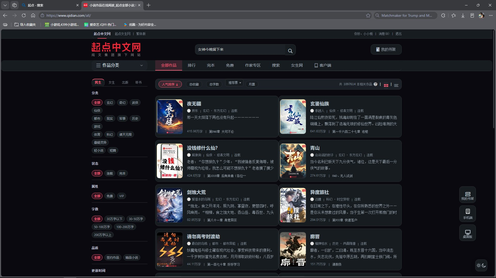
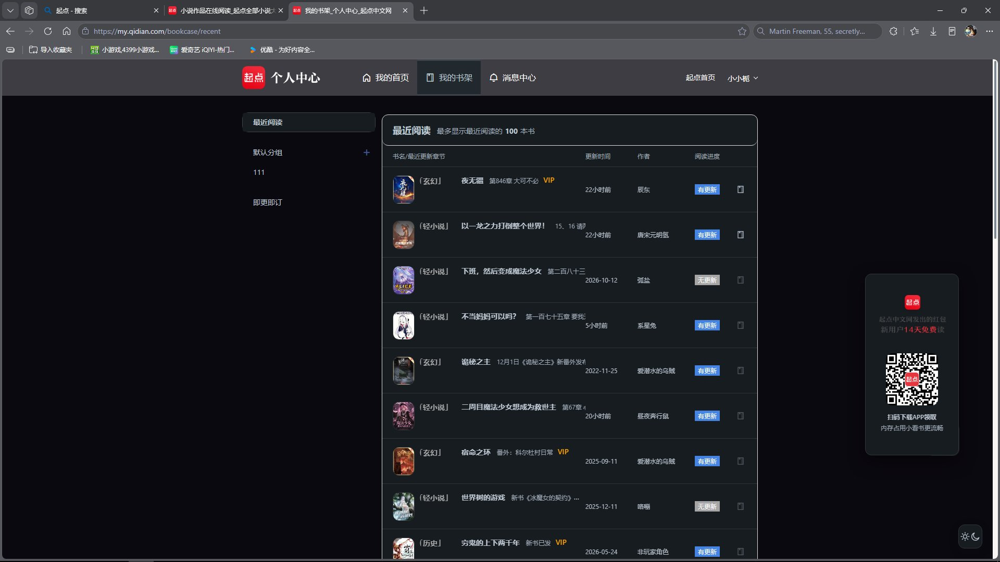
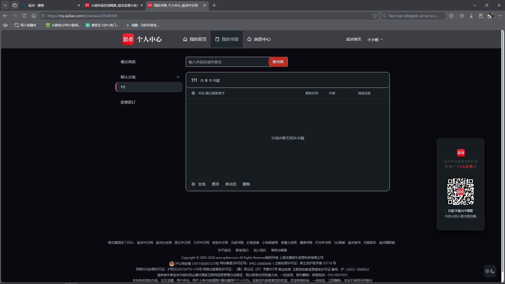
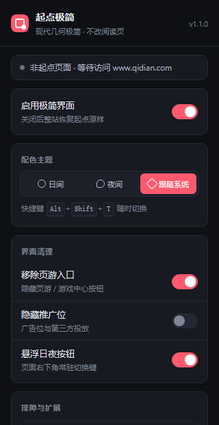

# 起点极简 · Qidian Minimal

> **由 DeepSeek-V4.1-Flash 完成创作**
>
> 本仓库由 **DeepSeek-V4.1-Flash** 上传与维护。

本项目（含全部代码、样式、自检与文档）由 **DeepSeek-V4.1-Flash** 独立完成创作。

把 **起点中文网** 改造成 **现代几何极简风** 的 Edge / Chrome 浏览器扩展（Manifest V3）。

> 一句话原则：**只优化「浏览侧」，绝不碰「阅读侧」。**
> 所有阅读页（`*/chapter/*`、`read.qidian.com`、`vipreader.qidian.com`）**完全不注入、不改样式**，一个字都不动。

---

## 效果一览

| 项目 | 改造前 | 改造后 |
| --- | --- | --- |
| 主导航 | `#3e3d43` 深灰底 + 白字 + 32px 大内边距 | 浅色条 + 发丝线 + 悬停强调色下划线（**v1.1.0 修复**：v1.0.0 把这里染成深灰，整条导航看不见） |
| 顶部工具条 | `#f7f7f7` + 白底描边块 | 表面色 + 当前站点用 2px 强调线下标 |
| 首页书单 | 216px 紧凑文字榜（31px 行高） | **保持紧凑**，只做发丝线、字色分级、推荐位强调色（**v1.1.0 修复**：v1.0.0 误改成网格，整块错位） |
| 配色 | 多层渐变、彩色块、红黄撞色 | 单一强调色 + 中性底 + 发丝线分层 |
| 按钮 / 书目 | 无框、彩色实心块 | **圆弧外框**：12px 圆角 + 1px 纤细线，框内统一色（夜间 `#171C20`，线 `#303539`） |
| 圆角 | 0 / 3 / 5 / 半圆混用 | 统一刻度 4 / 6 / 10 / 12 / 14 px |
| 榜单 | 灰/橙/黄三色数字块 | 前三名强调色系，其余中性，等宽数字对齐，每行圆弧外框 |
| 字体 | 站点旧式字号体系 | 系统字体栈、行高 1.7、字重 500/600，夜间字色 `#BEC8D2` |
| 页游入口 | 顶部随机广告条 + 导航里「页游」项 | **整条移除**（含只有链接被删而留下空白带的坑） |
| 全部作品页 `/all/` | 左侧筛选项是文字链接、右侧靠分隔线分书 | 左侧每个选项变**圆弧胶囊**（选中态强调色），右侧**每本书一个圆弧外框**，两列布局不变 |
| 日夜 | 无 | **日间 / 夜间 / 跟随系统**，夜间为**偏紫的近黑** |

**全部作品页 `/all/` · 夜间**（左侧七组筛选项圆弧胶囊 + 右侧每本书圆弧外框）



**个人中心 · 最近阅读 · 夜间**（书架自动补封面、封面与书名整列对齐、行不溢出卡片）



**个人中心 · 空分组 · 夜间**（白色卡片、表格、底部「全选/置顶/移动至/删除」全部压暗）



> 以上为**真实站点实机截图**。离线可复现的渲染示意图另见 `test/preview.html`、`test/preview-all.html` 与 `docs/preview-*.png`。

---

## 安装（Edge）

1. 打开 Edge，地址栏输入 `edge://extensions/` 回车；
2. 打开左下角 **开发人员模式**；
3. 点击 **加载解压缩的扩展**；
4. 选择本目录 `qidian-minimal`（含 `manifest.json` 的那一层）；
5. 打开 `https://www.qidian.com/`，右下角会出现日夜切换按钮。

> Chrome 同理：`chrome://extensions/` → 开发者模式 → 加载已解压的扩展程序。
> 详细图文步骤与常见问题见 [`docs/安装说明.txt`](docs/安装说明.txt)。

---

## 使用

- **悬浮按钮**：右下角，点击在日间 / 夜间之间切换（Shadow DOM 实现，不受起点样式干扰；位置在站点右下固定条**正下方**避让，不遮挡「我的书架 / 回到顶部」）。
- **切换方式**：页面右下角悬浮按钮，或浏览器工具栏的扩展图标（弹窗里三档可选）。
- **工具栏图标**：角标 `ON` = 当前页已优化；角标 `跳过` = 当前是阅读页，扩展主动让路。
- **弹窗开关**：启用极简界面 / 配色主题 / 移除页游入口 / 隐藏推广位（默认关）/ 悬浮日夜按钮。
- **导出当前页结构**：弹窗底部按钮，一键把当前页的 DOM 轮廓（标签 + id + class）复制到剪贴板，
  用来给还没被优化的页面补选择器 —— 见下方「如何扩展选择器」。



---

## 生效范围

| 域名 | 状态 |
| --- | --- |
| `www.qidian.com`、`qidian.com` | ✅ 完整优化（基于实抓 DOM 的精确选择器） |
| `my.qidian.com`（个人中心 / 书架）、`free.`、`all.`、`so.` 等子域 | ✅ 令牌层 + 表格发丝线 + 控件统一（这些模板未实抓，**精确优化待补**，见「如何扩展选择器」） |
| `read.`、`vipreader.`、`*.qidian.com/chapter/*` | ⛔ 阅读页：完全排除，零注入 |
| `passport.`、`ptlogin.`、`pay.`、`m.qidian.com` | ⛔ 登录 / 支付 / 移动端模板：排除，避免干扰 |

---

## 阅读页为什么不会被影响

三层独立防护，任何一层都足以挡住：

1. **清单层** —— `manifest.json` 的 `content_scripts[].exclude_matches` 排除了
   `*://read.qidian.com/*`、`*://vipreader.qidian.com/*`、`*://*.qidian.com/chapter/*`，
   脚本与样式**根本不会被注入**到阅读页；
2. **运行时层** —— `content.js` 的 `isReaderUrl()` 会在启动、`popstate`、`hashchange`、
   `pushState/replaceState` 之后重新判定，一旦命中阅读页立即 `teardown()`：
   摘掉全部 `data-qd-*` 标记、恢复被隐藏的节点、卸载悬浮按钮、删除注入的样式表；
3. **样式层** —— `theme.css` 里 **每一条规则** 都收在 `html[data-qd-minimal="on"]` 之下，
   该属性只在非阅读页被打上，样式不可能泄漏。

另外，日夜切换只改 `data-qd-theme` 属性，**不重载页面、不触发重排跳转**，浏览过程中切换不会打断你。

---

## 目录结构

```
qidian-minimal/
├── manifest.json            # MV3 清单：匹配规则 / 阅读页排除 / 快捷键
├── src/
│   ├── early.js             # document_start：同步打主题标记 + 首屏防闪
│   ├── theme.css            # 设计令牌 + 基于真实结构的分模块极简化（唯一样式来源）
│   ├── content.js           # 主题应用、悬浮按钮、页游清理、结构导出、阅读页守卫
│   └── background.js        # Service Worker：角标状态 + 快捷键转发
├── popup/                   # 工具栏弹窗（开关 / 主题 / 导出结构）
├── icons/                   # 16 / 32 / 48 / 128 图标（脚本生成）
├── test/preview.html        # 离线预览：首页（真实结构 + 站点样式模拟 + 真实 theme.css）
├── test/preview-all.html    # 离线预览：全部作品页 /all/（左筛选 + 两列书单）
├── tools/
│   ├── site-sim.css         # 站点样式模拟（预览页与断言页共用）
│   ├── audit.html           # 计算样式自检：逐条断言 getComputedStyle（日/夜两套）
│   ├── content-test.html    # 行为自检：页游清理 / 还原 / 悬浮按钮 / 主题 / 导出
│   ├── chapter/reader-test.html  # 阅读页守卫自检（跑在真实 /chapter/ 路径下）
│   ├── validate.mjs         # 静态自检：清单、引用、语法、CSS 规则扫描、令牌一致性、事故回归
│   ├── dom-outline.mjs      # 抓下来的 HTML → DOM 轮廓（反推真实选择器用）
│   ├── css-query.mjs        # 站点 CSS → 按关键字反查规则（确认真实配色尺寸用）
│   ├── test.ps1             # 一键跑完上面全部自检
│   ├── build.ps1            # 打包成 dist/*.zip
│   └── make_icons.py        # 生成图标
├── docs/安装说明.txt
└── LICENSE
```

---

## 本地预览（不联网）

直接双击打开，两页都可看，左下角切日 / 夜：

- `test/preview.html` —— **首页**真实结构（顶部工具条、页游入口广告带、品牌行 + 搜索、
  主导航、书单三栏、榜单、筛选条、页脚、右下固定条）。
- `test/preview-all.html` —— **全部作品页 `/all/`** 真实结构（左筛选七组 + 中间排序条 + 右侧两列书单）。

---

## 自检与打包

```powershell
# 一键跑完全部自检（静态 + 样式 + 行为 + 阅读页守卫），全绿退出码为 0
pwsh -File tools\test.ps1

# 只跑静态自检                         # 重新生成图标            # 打包
node tools\validate.mjs                # python tools\make_icons.py   # pwsh -File tools\build.ps1
```

自检不联网、不碰真实站点，全部在本地 headless Edge 里完成：

| 检查 | 断言数 | 覆盖内容 |
| --- | --- | --- |
| `validate.mjs` | 34 项 | 清单合法性、引用文件、JS 语法、注释定界符配对、CSS 规则扫描、令牌定义与引用一致性、作用域收窄、**事故回归防线**（禁止裸 `a` 全局改色 / 禁止把 `.book-list` 改成网格 / 真实页游入口两侧都要处理） |
| `audit.html` | 149 项 × 2 主题 | 直接读取 `getComputedStyle`：令牌落地、工具条、主导航（浅色可读）、搜索、**每本书 / 每个按键的圆弧外框（12px 圆角、框内色、1px 框线）**、书单保持 216px 紧凑榜、榜单数字块、筛选条、页脚、右下固定条、写死浅色底兜底、表格降级层、**`/all/` 页筛选胶囊与两列书单（含「内容不溢出 102+16+344 ≤ 467」的宽度断言）**、作用域 |
| `content-test.html` | 30 项 | 真实页游入口（`#j-topOpBox` / `#topGameOp` / `li#game-web`）整块隐藏且能还原、「游戏竞技」与长文本容器不被误删、悬浮按钮避让固定条、点击切主题、`localStorage` 镜像、消息接口、结构导出 |
| `chapter/reader-test.html` | 17 项 | 在真实 `/chapter/` 路径下：零注入、标记被抹除、样式表被移除、阅读页字号/行高/宽度/配色/页游入口原样 |

---

## 如何扩展选择器（某页面没被优化时）

```powershell
# 1) 把线上页面的真实 DOM 抓下来
msedge --headless=new --dump-dom "https://www.qidian.com/" > home.html
node tools\dom-outline.mjs home.html 10 > outline.txt      # 看结构轮廓

# 2) 把站点的样式表抓下来，反查真实配色与尺寸
node tools\css-query.mjs index.css "main-nav" "book-list" "page-bottom-fixed"
```

或者在浏览器里直接用弹窗的 **导出当前页结构**（登录页 / 书架页这类抓不到的页面走这条），
把导出的轮廓发回来，就能照 `src/theme.css` 的分节格式补上精确规则。

- **换强调色**：改 `src/theme.css` 第 1 / 2 / 3 节的 `--qd-accent` / `--qd-accent-hover`（日间、夜间显式、夜间跟随系统各一处）。
- **改夜间紫调**：第 2 / 3 节的 `--qd-bg` / `--qd-surface*` / `--qd-border*`（当前是 `#0b0910` 起步的近黑偏紫）。
- **加选择器**：保持 `html[data-qd-minimal="on"]` 前缀（`validate.mjs` 会检查作用域收窄）。
- **页游清理**：`src/content.js` 的 `GAME_SELECTORS`（真实入口，整块隐藏）+ `GAME_TEXT`（**必须 `^...$` 锚定**，否则误伤「游戏竞技」分类）。

---

## 已知边界

- `www.qidian.com` 的选择器来自 2026-10 的实抓 DOM 与 189KB 站点 CSS；站点改版后个别模块可能失效 ——
  但令牌层（配色、字体、圆角、发丝线）不依赖具体 `class`，不会「整体失效」。
- `my.qidian.com`（书架）需要登录才能拿到结构，因此目前只有令牌层 + 表格 / 控件级优化；
  用弹窗「导出当前页结构」发回来即可做精确版。
- 隐藏推广位默认**关闭**（`#banner-two/#banner3/#banner4`、`ins.adsbygoogle`、属性边界为 `ad-*` 的容器），
  刻意避开 `load-more` 这类含 `ad-` 的真实类名。
- 本扩展不联网、不上报、不采集数据，只做本地 DOM 与样式整理。

---

## 变更记录

### v1.7.0 — 详情页并入夜间 + 排行榜排版 + 全局圆弧 + 频道页横幅

**1. 书籍详情页并入夜间（撤销 v1.4.0 的固定日间）**
当初固定日间是因为「给 html 设背景 → body 背景不再传播 → 盖住站点的负层级浅色层」，
那一层根本原因在 v1.4.0 已修掉，所以这一页可以正常夜间了。
改动覆盖所有入口：`early.js` 首屏预置、`resolvedTheme()`、`applySettings()`、
两个消息处理器（`qd:toggle-theme` / `qd:cycle-theme`）、跟随系统的监听、
以及 `qd:state` 上报。现在悬浮按钮、快捷键、弹窗切换在这一页全都正常。

**2. 排行榜页排版**
首页榜单是 5 栏、`/rank/` 是 **8 栏** —— 8 栏挤在一行每栏只剩约 150px。
`.rank-list-row` 从 flex 改成 **grid + `repeat(auto-fill, minmax(232px, 1fr))`**：
栏数随宽度自动决定、装不下就换行，两个页面共用一套规则。
同时必须放开站点写死的 `height:423px + overflow:hidden`，否则换行后的第二行会被整行裁掉。

**3. 全局圆弧边框（强制）**
新增规则：按钮/输入框/卡片/面板/标签/弹窗/列表项/图片/表格… 一律 `--qd-r-box`（12px），
小控件用 9px 避免变成胶囊，本来就是圆形的（圆形头像、圆点）保持胶囊形。
只改圆角、不动尺寸与位置，所以即使误命中也不会破坏布局。

**4. 频道页（`/xianxia/` 这类）顶部横幅删除**
实抓确认：那块横幅**既没有 banner 类名、也没有 ``**（是 CSS 背景图），
所以按几何 + 内容特征识别并打 `data-qd-hidebanner`：位于页面上部（top < 620）、
宽 ≥ 视口一半、高 ≥ 140、且有背景图或含 logo 子元素 —— 只处理最靠上的那一个，
避免误伤正文大图；关闭扩展时原样恢复。

**5. 「新书精选」溢出圆角框**
`.new-wrap` 加 `overflow: hidden` + 圆角，内部标题单行省略号、正文 `overflow-wrap: anywhere`
（实抓结构：`div.new-wrap > h3 > span` + `ul > li`）。

**6. 自检**
详情页那 15 条断言从「固定日间」整组翻成「夜间正常生效」（含快捷键、状态接口、导航描边色）；
审计里的榜单断言改为接受 grid；书架封面圆角跟随全局规则改为 12px。

### v1.6.5 — 非全屏下的亮色 + 窄窗口下书名被挤成「…」

截图（非全屏）暴露了三个真实缺陷，都在这一版修掉：

**1. 后出现的元素永远不会被扫描（底部操作条一直是白的）**
站点很多条（底部「全选/置顶/移动至/删除」、浮层）是**先渲染好、靠切 class 才显示**的，
而我的 MutationObserver 只盯 `childList` → 它们永远进不了自适应范围。
现在同时盯 `class / style / hidden / aria-hidden`，并把自己的 `data-qd-*` 标记排除在外避免自触发。

**2. 防抖写成了「丢弃」而不是「推迟」**
`adaptUnknownTemplate()` 里有「距上次扫描不足 1.2s 就 return」的保护 —— 但它直接
**丢掉了这次扫描**，触发它的那一次变化（刚显示出来的白条）就再也没机会被处理。
改成算出差额后重新排期。

**3. 窄窗口下书名被挤成「…」**
非全屏时书格变窄，封面 + 统一宽度的标签把书名挤到只剩省略号。
新增 `verifyCoversFit()` 自检退让，判据不是写死断点，而是**量症状**：
`nowrap + ellipsis` 元素的 `scrollWidth`（完整文字宽度）比 `clientWidth`（可见宽度）
还长 1.5 倍以上，就是被压扁了。只要过半书名如此，就依次退让 ——
① 先放弃标签统一宽度（对齐是加分项，书名可读是底线）→ ② 仍不够就把封面缩小一档。
- 判据刻意**不用元素盒子宽度**：书名是块级元素，盒子宽度 = 整格宽度，
  真正被压缩的是**行盒**（浮动封面把行盒挤短），量盒子根本量不出来 —— 第一版就栽在这里。
- 只有个别行窄不触发全局退让（避免误伤正常行），自检里有反向断言守着。

**4. 自检扩到三阶段**（68 → 72 项）：第一次断言在 700ms；第二阶段把白条 `hidden` 去掉、
验证观察器确实重新扫描并压暗它；第三阶段压窄书格、验证真的会退让。

### v1.6.4 — 书架书名消失（我引入的回归）+ 选中行亮色

**1. 书名整列变成「…」——v1.6.2/v1.6.3 引入的回归，本次修复**
统一标签宽度时，我用「兄弟遍历」找封面与书名之间的元素；但真实 DOM 常是
`td > div.book-info > (em.tag + a书名)` —— 书名在那个容器**里面**，兄弟遍历会走到容器上，
把它当成标签（`inline-block` + `nowrap` + `min-width`）→ 整块被折成一行压成「…」。
- 改为从书名链接**往上**逐层标记「排在它前面的叶子元素」，且**绝不含书名链接**；
  行内结构（`td > em.tag + a`）与容器结构（`td > div > em.tag + a`）都能正确标记。
- 加兜底：量到标签宽度 > 200px 就放弃对齐 —— 那说明标到了容器，宁可不对齐也不能压坏书名。
- 封面定位由 `inline-block` 改成 `float`：块级容器结构下 inline-block 会各占一行，
  把封面挤到书名上方；float 两种结构都能让文字绕排在封面右侧。

**2. 选中行仍是亮色**
站点把浅色高亮刷在 `tr` **和** `td` 上，class 命名未知。改为**与兄弟行对比**识别：
同一父容器里，某行被刷成亮色而兄弟行没有 → 判定为选中态 → 压成 `surface-3` + 左侧强调色竖条。
- ⚠ 关键细节：必须在主扫描**过程中**缓存原始底色再用。主扫描会先给亮块打 `data-qd-light`，
  之后再读 `getComputedStyle` 拿到的已经是被压暗后的颜色 —— 第一版就是这么写的，
  判断「这行是不是亮的」永远是 false，选中行识别完全不生效。
- 同时保留按 class 的兜底规则（`select/active/check/current/selected/checked`）。

**3. 自检**
53 → **67** 项，其中两条专门守这次的回归：
「书名没有被压成省略号」（量 `getBoundingClientRect().width`，不是查样式属性）
与「选中行不再是亮色」（量实际底色），并且都用**结构不同**的夹具覆盖：
行内标签、容器包裹、块级标题三种书名结构 + `tr`/`td` 双层高亮。

### v1.6.3 — 书架行溢出边框修复 + 全页对齐复检

- **行溢出卡片边框**（最近阅读页）：站点把列表卡片按「原行高 × 条数」写死高度，
  而注入封面会让每行变高 → 行跑到卡片外面、压住页脚。
  新增 `relaxRowContainers()`：从被注入的行往上找祖先，只对
  「高度写死」+「内容确实比盒子高」+「overflow 是 visible 或 hidden」的祖先
  加 `.qd-grow`（放开固定高度）。
  实测：卡片 `70px → 364px`，**溢出卡片外的行 = 0**。
  - 刻意**不碰** `overflow: auto/scroll` 的容器 —— 那是站点有意做的内滚动区，
    内容高于盒子属正常，放开高度只会破坏它的滚动（自检里有一条断言守着）。
  - 也不碰 `table/tr/td` —— 表格的 height 只是建议值，不会真的裁内容。
- **全页对齐复检**：新增按「书目组」分组的对齐断言 —— 每组内所有封面左边缘必须相同、
  所有书名起点必须相同、所有标签占位必须相同，且覆盖表格模板与 `ul/li` 模板。
  截图里那页（最近阅读）正是这样被复检过的。
- 个人中心自检 45 → 53 项。

### v1.6.2 — 书架封面排版：从「调参数」改成「量出来」

上一版给标签写了 `min-width: 74px` —— 那是个拍脑袋的魔数，只能盖住 1~4 字的标签，
碰上「诸天无限」「现代言情」这种稍长的分类就又歪了。这一版把**所有硬编码都换成实测**：

- **标签列宽改为运行时测量**：`syncCoverTagWidth()` 取当前页面上**最长标签的自然宽度**，
  写进 CSS 变量 `--qd-tag-w`，CSS 只写 `min-width: var(--qd-tag-w, 0px)`。
  实测（三种长度的标签同页）：`--qd-tag-w = 84px`，2/3/4 字的标签全部渲染成 84px，
  三行封面左边缘都是 262 —— **任何作品、任何长度的标签都对齐，换模板也不用改代码**。
  测量前会先清掉变量（否则量到的是被撑开后的宽度，自反馈），并向上取整到 2px
  避免亚像素抖动导致来回改宽度；视口变化与 `document.fonts.ready` 后都会重量一次。
- **行识别也去掉模板假设**：`a.closest('tr')` → `a.closest('tr, li, dd')`。
  排除封面轮播不再依赖「必须是表格行」，而是普世规则：**行内已经有 `` 就跳过**
  （轮播项自带封面，天然被排除）。所以表格模板、`ul/li` 模板都能补封面。
- 测试同步改成**验证普世性**而不是验证某个数值：同一页放三种长度的标签（2/3/4 字）
  + 一个 `ul/li` 列表 + 一个已有图的行，断言「所有封面左边缘相同」「所有书名起点相同」
  「标签占位宽度一致」「没有标签被压窄」。
- 自检里新加的「未定义令牌」防线立刻发挥了作用：`var(--qd-tag-w, 0px)` 一开始
  没在 CSS 里声明，静态自检直接报错 → 补上带注释的默认值。
  个人中心自检 43 → 45 项。

### v1.6.1 — 书架封面排版对齐

- **封面插到书格最前面**：原来是插在书名链接之前，而链接前面还有长度不一的分类标签
  （「轻小说」/「玄幻」/「历史」…），导致每本书的封面左边缘**参差不齐**。
  现在封面永远是书格的第一个子元素 → 整列封面左边缘成一条竖线。
- **标签统一占位宽度**（`min-width: 74px`）：实测「轻小说」带书名号 65px、「玄幻」52px，
  两者会把书名起点挤出 14px 的差；统一后 1~4 字的标签都能对齐，书名起点也成一条线。
- **封面用 `<a>` 包裹**：可点击进入该书详情页（`tabindex="-1"` 避免多出 Tab 停靠点）。
- 封面圆角由 6px 提到 10px、右间距统一 10px、书格统一 `vertical-align: middle`，
  让封面、标签、书名、章节落在同一中线上。
- 自检里加了两条**几何对齐断言**：两本书的封面左边缘必须相等、书名起点必须相等 ——
  这类"看起来乱"的问题只有量坐标才盯得住。个人中心自检 33 → 43 项。

### v1.6.0 — 首页排行榜修复 + 夜间「横扫大面积亮色」+ 全站字体可读性

**1. 排行榜回归修复（截图 P3）**
- 榜首是一条 `li.unfold`，里面装的是**整张 `.book-wrap` 卡**（站点高度 114px）。
  v1.5.0 把它套进了单行的 `height: 29px + overflow: hidden` → 整卡被裁成只剩「NO.1」，
  书名/封面/数字全没了。现在 `.unfold` 被排除在单行规则之外。
- **单行书名消失的真正原因**（顺带挖出来的老 bug）：单行内容 =
  `.num-box 28px` + `.name-box 188px`（`a.name` 116 + `i.total` 72）= **216px**，
  列宽不足时 float 会**换行**，而 `li` 有 `overflow: hidden` → 换行后的书名被整条裁掉。
  诊断数据：`name-box rect=77,200` 而 `li` 是 `173..202`，正好落在裁切区外。
  现在单行改用 flex（书名自动收窄打省略号），任何列宽都不再换行。
- 五栏之间加 `gap: 16px` 并各自加圆角容器（原来紧贴在一起，很挤）。

**2. 夜间横扫大面积亮色**
自适应规则从「近白**且**近灰」升级为「**面积 ≥ 6000px² 的亮底，不看色相**一律压成表面色」，
小面积彩色块（徽标/标签/小按钮）保持原样。选中的书（站点用浅色高亮）也统一改成
暗色选中：`tr/li[class*=select|active|check|current]`、`[class*=selected|checked]`
→ 表面色 + 左侧强调色竖条。

**3. 全站字体可读性（新增「有效底色」算法）**
自下而上算出每个元素的真实底色（自身不透明底，否则继承最近祖先），
凡是「暗底 + 暗字」一律提亮 —— 不再局限于亮块内部。因此
侧栏未选中项、底部「全选 / 置顶 / 移动至 / 删除」操作条、
页脚「阅文集团旗下平台」那一串链接全部被修好。
亮度 ≥ 0.5 的文字仍然不动，避免把层级压平。

**4. 书架细节**
- 封面注入收紧为**只认表格行**（`tr`）且行内没有 `img`：顶部「编辑推荐 / 游戏推荐」
  那种封面轮播不会再被塞小封面（截图 P1 的问题）。
- 「游戏推荐」这个标签页加入游戏入口清理名单，直接移除。

**5. 自检**
静态 40 项、计算样式 **183 × 2**、行为 30、阅读页守卫 17、详情页日间锁 15、
个人中心自适应 33。新增的排行榜断言里有一条专门盯着这个坑：
「书名不会被浮动换行裁掉」——直接比较 `.name-box` 与 `li` 的 top 差值。

### v1.5.0 — 个人中心全家族夜间自适应 + 书架封面

个人中心（`my.qidian.com`：书架 / 消息中心 / 即更即订 / 最近阅读 / 用户等级 /
财务中心 / 我的票夹 / 我的红包 / 我的书评 / 我的本章说 / 徽章称号 …）
需要登录才能拿到真实 DOM，无法逐个写选择器，页与页之间也没有可靠的公共前缀。
所以这一族改为**运行时自适应**，而不是继续猜 class：

**1. 夜间自适应（`content.js` 探测 + `theme.css` 映射）**
- 探测「近白**且**近灰」的底色块（站点写死的 `#fff / #fafafa / #f7f7fc` …）→ 打 `data-qd-light`
  → 换成表面色 `#171C20`。白色卡片、表格、**弹窗**、侧栏选中项都在其中。
- 探测这些块上的深色文字 → 打 `data-qd-text` / `data-qd-text2` → 换成主题文字色，**保辨认性**。
  判定用**亮度**而不是「是否近黑」：站点常用的 `#333` 正文、`#666` 次要文字、
  以及 `#3f5a93` 这类**暗蓝链接**都会被接管（否则换成深底后全糊）。
  亮度 ≥ 0.5 的文字（如 `#999`，在深底上仍有约 4.1:1 对比度）刻意不动，避免过度接管。
- 低饱和要求让**浅红/浅蓝这类彩色底不被误伤**；站点自带的深色顶栏（`#3e3d43` + 站点红）
  也原样保留。
- 只在夜间生效：规则全部限定在 `[data-qd-resolved="dark"]` 之下，切回日间会清空所有标记，
  日间页面一个字节都不动；`validate.mjs` 会检查「未限定夜间」与「改了布局属性」两种情况。

**2. 书架显示封面**
站点封面地址是有规律可循的，实抓验证 `qdbimg/349573` 为常量（20/20 一致）：
`https://bookcover.yuewen.com/qdbimg/349573/{书号}/150.webp`。
书号直接从每行的 `/book/{id}/` 链接里取，**因此不需要知道这一页的 class**，
每行注入一张 40×53 圆角封面（懒加载 + 取不到自动移除，不留破图）。仅在 `/bookcase` 路径生效。

**3. 自检**
新增 `tools/bookcase/list-test.html`（28 项）：在真实 `/bookcase/` 路径下验证
白块/弹窗/选中项被接管且颜色正确、深色文字提亮、**深色但带彩的链接也提亮**、
站点深色顶栏与浅蓝卡片不被误伤、封面地址与尺寸正确、同行不重复注入。
`validate.mjs` 新增 6 条回归防线（标记两侧接线、夜间限定、只改颜色不改布局、封面地址规律、
路径限制）。本轮规模：静态 40 项、计算样式 168 × 2、行为 30、阅读页守卫 17、
详情页日间锁 15、个人中心自适应 28。

### v1.4.0 — 书籍详情页固定日间 + 负层级装饰层修复 + `/all/` 底部配色

**1. 书籍详情页（`/book/{id}/`）不再套夜间。** 这一页是站点另一套模板
（顶部是 `.nav-wrap`、首屏是 `.book-detail` 玻璃拟态卡），夜间在那一页必然半黑半白。
现在该页**固定日间**：不挂悬浮切换按钮、`Alt+Shift+T` 不响应、弹窗显示「固定日间」、
工具栏角标显示「日间」。日间下的圆角外框等优化照常生效。

**2. 一个影响面更大的根因修复：绝不给 `html` 设背景。**
CSS 规定「只有根元素 `html` 没有背景时，`body` 的背景才会传播到画布，且 body 自身不再绘制」。
站点大量使用**负层级装饰层**（详情页首屏的 `#gradient` / `#bg-left` / `#bg-right` 都是
`z-index:-9 / -10`）。`body` 的背景属于普通块级背景，绘制在负层级**之后** ——
所以我一旦同时给 `html` 设背景，传播被禁用，body 背景真的被绘制，把整片浅色玻璃首屏盖住。
现在只给 `body` 设底色（继续享受传播），`html` 保持无背景。
用 A/B 像素采样验证（`tools/propagation-test.html`）：

  | 场景 | 旧写法（给 html 设背景） | 修复后 |
  | --- | --- | --- |
  | 夜间 · 首屏装饰层位置 | `(11,9,16)` 被我的底色盖住 | `(247,247,252)` = 站点的 `#f7f7fc` ✓ |
  | 日间 · 首屏装饰层位置 | `(244,245,247)` 同样被盖住 | `(247,247,252)` ✓ |

**3. `/all/` 页底部三处配色。**
- 「本周热推」书名：站点写死 `color:#000`，夜间直接看不见 → 改为次级文字色，悬浮强调色。
- 分页（`.lbf-pagination-item`）：站点只给了 `1px solid #fff` 描边、**没有字色** →
  统一成圆弧外框（框内=表面色、1px 框线、可读字色），当前页强调色实心，禁用页弱化。
- 右下固定条（我的书架 / 手机端 / 桌面版 / 回到顶部）：文字由三级色提亮到二级色，
  iconfont 图标用主文字色；扫码/红包/听书/回顶这几个是 **PNG 雪碧图**，字色管不着，
  夜间用 `filter: invert(1)` 反相成浅色，否则深灰图标贴在深底上等于隐形。

**4. 自检体系修正。**
- 新增 `tools/book/detail-test.html`：在真实 `/book/` 路径下验证固定日间、拒绝日夜切换、
  负层级层未被遮挡（15 项）。
- 新增 `tools/propagation-test.html`：负层级装饰层的 A/B 像素验证页。
- **修好了 runner 的失败计数**：原来用 `'| FAIL'` 模式去数失败行，而页面输出是
  `CT FAIL | 描述`（管道在 FAIL 之后），这个模式永远匹配不到 —— 上一轮 9 个 FAIL
  被它报成「全部自检通过」。现在直接解析 SUMMARY 行的 `fail=N`。
- 本轮规模：静态 34 项、计算样式 **168 项 × 2 主题**、行为 30 项、阅读页守卫 17 项、
  详情页日间锁 15 项。

### v1.3.1 — 修复顶部品牌行两侧的黑块

- **现象**：`/all/`（首页同样）顶部「起点中文网」那一行的左右两侧各出现一块黑。
- **根因**：这一行在站点里同时带 `.box-center`，而站点 CSS 里 `.box-center{width:1200px}`
  排在 `.logo-wrap{width:100%}` 之后、**赢了**，所以这一行实际只有 `1200px` 宽；
  我给它设的背景色只铺满中间那 1200px，两侧（1920 屏下各约 360px）就露出页面底色。
- **修法**：元素自身铺底色 **+** `box-shadow: 0 0 0 100vmax <底色>` 把盒子**外侧**也铺满，
  再用 `clip-path: inset(0 -100vmax)` 裁成这一行的水平条带；底部发丝线改用伪元素铺满整行。
  注意两者缺一不可 —— **box-shadow 不会画在元素盒子内部**，只铺外壳。
- **验证**：用像素采样做前后对比（品牌行上取 左/左内/中/右内/右 五个点）：

  | 采样点（y=85） | 修复前 | 修复后 |
  | --- | --- | --- |
  | 最左 x=10 | `(11,9,16)` 页面底色 → 黑块 | `(23,28,32)` = `#171C20` |
  | 左内 x=360 | `(23,28,32)`（被 logo 图挡住看不出问题） | `(23,28,32)` |
  | 中间 | `(27,33,38)` 搜索框 | `(27,33,38)` |
  | 右内 x=1040 | `(23,28,32)` | `(23,28,32)` |
  | 最右 x=1390 | `(11,9,16)` → 黑块 | `(23,28,32)` |

  这条教训值得记下来：光看截图会漏 —— 我第一版只加 `box-shadow` 忘了元素自身底色，
  外壳铺满、盒内反而露底，而采样点恰好落在红色 logo 上，肉眼验收会被骗过去。
  自检里现在有 3 条断言锁死：盒内色 / 阴影色 / 裁切，外加伪元素线色与「有效宽度仍是 1200px 未改动站点布局」。

### v1.3.0 — 全部作品页（`/all/`）

- 实抓 `www.qidian.com/all/`（104KB DOM + 157KB CSS）后补齐这一页的精确规则：
  **左侧筛选**（分类 / 状态 / 属性 / 字数 / 品质 / 更新时间 / 标签）的每个选项
  （真实标记 `.select-list .work-filter ul li`）都变成圆弧胶囊，选中态从站点原来的 `#333` 黑块
  改为强调色；「已选条件」「子分类浮层」「男生/女生/出版/听书」标签头一并主题化。
- **右侧每本书一个圆弧外框**（`.book-img-text .all-img-list li`），封面圆角化并去掉旧投影。
- 尺寸全部按真实值算：单本 = 封面 `102` + 间距 `16` + 信息区 `344` = `462px`；
  容器宽 `477px`、`box-sizing:border-box`、左右内边距各 `4px` ⇒ 可用 `467px`，
  两列浮动与 `477px` 宽度都不会被破坏（自检里有这条宽度断言）。
- 中间工具条的排序按钮（人气排序 / 总收藏 / 总字数 / 推荐票 / 月票）也统一为圆弧外框胶囊。
- 新增离线预览 `test/preview-all.html`，自检从 115 项增加到 149 项 × 2 主题。

### v1.2.0 — 圆弧外框 + 指定配色

- **每个可按按键 + 每本书都加圆弧外框**：12px 圆角、1px 纤细线、框内统一表面色。
  覆盖 `.red-btn / .blue-btn / .grey-btn / .free-blue-btn / .btn / button / input[submit]`、
  我的书架、搜索按钮、右下固定条卡片、下载面板按钮，以及
  **首页三栏书单行**、**榜单行**、**带封面的书卡 `.book-wrap`**、**限时免费卡**、**编辑推荐卡**。
- **夜间三处色号按指定值**：框内 `#171C20`、框线 `#303539`、文字 `#BEC8D2`
  （页面底色仍保留上一版要求的"偏紫近黑" `#0b0910`；次级文字由 `#BEC8D2` 逐级压暗派生）。
- **加框不等于涨高**：`.index-two-wrap .book-list ul` 写死 `height:568px + overflow:hidden`，
  实测每列正好 18 行 → 单行定为 `29px + 2px 间距 = 558px`，不会溢出；
  行内浮动改成 flex，避免加边框/内边距后 float 换行被裁掉。
- 强调色从"实心填充"改为"悬浮 / 按下时出现"，按钮在页面里依然找得到。
- 自检里新增 34 条与圆弧外框、指定色号相关的断言（`audit.html` 81 → 115 项）。

### v1.1.0 — 按真实 DOM 重写样式层

拿到用户线上截图后，用 headless Edge 实抓了 `www.qidian.com` 首页（232KB DOM）与站点主样式表（189KB CSS），
定位并修复了 v1.0.0 的三个真实事故：

1. **主导航字看不见** —— 站点 `.main-nav` 是 `#3e3d43` 深灰底 + 白字，而 v1.0.0 用
   `[class*='nav'] > ul > li > a { color: 深灰 }` 全局改色，深底上的导航项直接消失。
   现在改为精确选择器，并把整条导航改成浅色条。
2. **首页大片空白 / 错位** —— 站点 `.book-list-wrap` 只有 216px 宽、31px 行高，是**紧凑文字榜**；
   v1.0.0 却用 `[class*='book-list'] > ul { display: grid; minmax(360px,1fr) }` + `li` 卡片化，
   把 216px 的容器撑到 360px+，配合 `overflow:hidden` 直接压塌版面。
   现已彻底移除网格/卡片规则，并在自检里加了「`.book-list` 不得为 grid」的回归断言。
3. **页游入口只删了一半** —— 真实入口是顶部随机广告条 `#j-topOpBox > #topGameOp`（JS 会 inline 设
   `display:block`）与导航 `li#game-web`；v1.0.0 只把里面的 `<a>` 藏了，留下一条 60px 空白带 + 关闭按钮。
   现在按真实标记整块隐藏，并能在关闭开关时原样还原。

同时：夜间配色改为**偏紫的近黑**（`#0b0910` 起）；匹配范围扩到 `*.qidian.com`（书架等子域，排除登录/支付/移动端/阅读页）；
新增弹窗「导出当前页结构」；移除已无意义的「书单网格排版」开关；隐藏推广位默认关闭。

### v1.0.0 — 首个版本

几何极简主题、日间/夜间/跟随系统、悬浮切换按钮、页游入口移除、阅读页三层隔离。
发布前由 `tools/audit.html` 抓到并修复：`theme.css` 头部注释正文里出现了 `*/`（写作 `*/chapter/*`），
导致注释提前闭合、**整块设计令牌规则被解析成 `chapter html[...]` 而全部失效**。
现已在 `validate.mjs` 里加了注释定界符配对、令牌规则选择器、未定义 `var(--qd-*)` 引用三重防线。

## 许可

[MIT](LICENSE)
